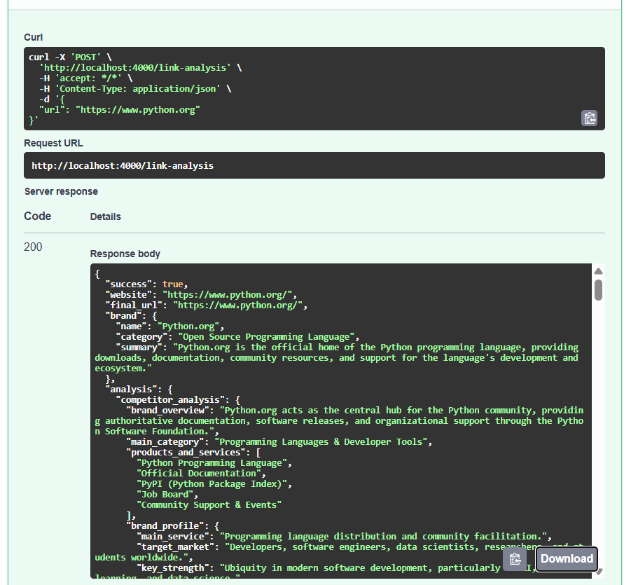
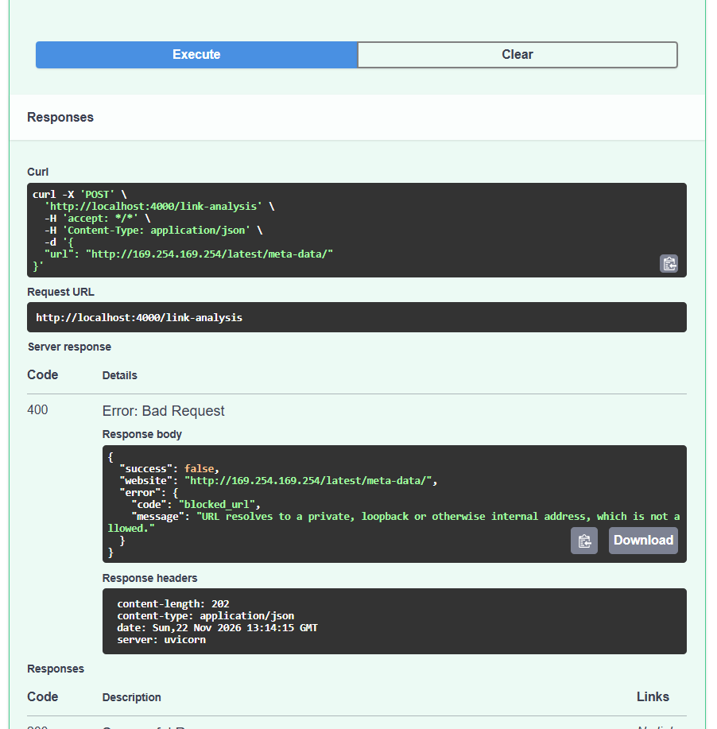
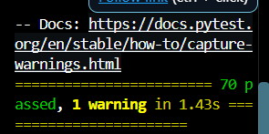

# AI-Powered Website Link Analysis API

A FastAPI service that takes a website URL, fetches and cleans its content, and uses an LLM to return a structured JSON analysis in five sections:

1. **Competitor vs your brand**: brand overview, products and services, at least 3 competitors with strengths and gaps, a comparison table, advantages and opportunities
2. **Top 5 target search queries** across Google, Facebook, Instagram, LinkedIn and X, with intent, relevance and audience (no invented search volumes)
3. **SEO improvements**: primary, secondary, long-tail and business keywords, recommended title and meta description (checked against the current ones), supporting content ideas
4. **Top 5 services**, each labelled `website_content` (with a quote verified against the site text) or `inferred`
5. **Target audience**: primary and secondary audiences, industries, business types, profiles, location, needs, challenges, interests and recommended segments

```
POST http://localhost:4000/link-analysis
{ "url": "https://example.com" }
```

Supports **Google Gemini, OpenAI and Anthropic** with native structured JSON output, an automatic fallback provider, SSRF protection, caching and per-request cost reporting. The LLM research and the final model recommendation are in [section 7](#7-llm-platform--model-research).

---

## Contents
1. [How it works](#1-how-it-works)
2. [Project structure](#2-project-structure)
3. [Setup (VS Code)](#3-setup-vs-code)
4. [Run and try it](#4-run-and-try-it)
5. [Response format](#5-response-format)
6. [Accuracy safeguards](#6-accuracy-safeguards)
7. [LLM platform & model research](#7-llm-platform--model-research)
8. [Security: URL validation and SSRF protection](#8-security-url-validation-and-ssrf-protection)
9. [Error handling](#9-error-handling)
10. [Tests](#10-tests)
11. [Deployment (live demo)](#11-deployment-live-demo)
12. [Screenshots and logs](#12-screenshots-and-logs)

---

## 1. How it works

```
POST /link-analysis {url}
  │
  ├─ 1. validate + normalise URL (http/https only, no credentials, ports 80/443)
  ├─ 2. SSRF check: resolve DNS, reject private / loopback / link-local / metadata IPs
  ├─ 3. cache lookup (URL + model) ──────────────────────────────► cached response
  ├─ 4. fetch HTML (manual redirects, each hop re-checked, 2 MB cap, HTML only)
  ├─ 5. extract: title, meta, OpenGraph, JSON-LD organisation data, headings, nav,
  │      contact, social profiles, footer; remove scripts/styles/nav/cookie banners;
  │      de-duplicate lines; cap at 12,000 chars
  ├─ 6. fetch up to 2 sub-pages (services, about) for better understanding
  ├─ 7. optional: Brave web search for competitors (grounding)
  ├─ 8. ONE LLM call → strict JSON Schema output (all 5 sections)
  ├─ 9. validate with Pydantic → one automatic repair retry → fallback provider
  ├─10. deterministic checks: competitor sources, service quotes, query count and
  │      platform coverage, SEO lengths, comparison table
  └─11. JSON response + meta (tokens, cost, latency, pages, warnings)
```

## 2. Project structure

```
ai-link-analysis/
├── app/
│   ├── main.py                    # FastAPI app, routes, error mapping
│   ├── config.py                  # env settings + model price table
│   ├── schemas.py                 # request, LLM output schema, response models
│   ├── services/
│   │   ├── website_extractor.py   # safe fetch + HTML cleaning/extraction
│   │   ├── llm_service.py         # Gemini / OpenAI / Anthropic providers, JSON Schema
│   │   ├── analysis_service.py    # orchestration, verification, cache, fallback
│   │   ├── competitor_service.py  # optional web-search grounding (Brave)
│   │   └── prompts.py             # system/user prompts
│   └── utils/
│       ├── validators.py          # URL validation + SSRF protection
│       └── cache.py               # TTL/LRU cache with in-flight de-duplication
├── tests/                         # 70 tests, no network needed
├── scripts/
│   ├── benchmark_llms.py          # measures latency/tokens/cost per model
│   └── demo_request.py            # calls the API, saves the response to docs/
├── requests.http                  # ready-made requests (VS Code REST Client)
├── .env.example  requirements.txt  requirements-dev.txt
├── Dockerfile  render.yaml  vercel.json  ruff.toml
└── README.md
```

## 3. Setup (VS Code)

Requirements: **Python 3.10+** (3.12 recommended).

```bash
cd ai-link-analysis
python -m venv .venv
# Windows (PowerShell):  .venv\Scripts\Activate.ps1
# macOS / Linux:         source .venv/bin/activate
pip install -r requirements-dev.txt
cp .env.example .env          # Windows: copy .env.example .env
```

Put at least one LLM key in `.env`. The quickest free option is a **Gemini key** from https://aistudio.google.com/apikey with `LLM_PROVIDER=gemini`. For the recommended production setup, see [section 7.4](#74-final-recommendation).

In VS Code: **File → Open Folder → `ai-link-analysis`**, accept the recommended extensions, then select the `.venv` interpreter (`Ctrl+Shift+P` → *Python: Select Interpreter*).

## 4. Run and try it

```bash
uvicorn app.main:app --host 0.0.0.0 --port 4000
# or VS Code: Run and Debug → "Run API (uvicorn :4000)"
```

* Swagger UI: **http://localhost:4000/docs** → `POST /link-analysis` → *Try it out*
* `GET /health` shows the active provider/model and whether its key is set
* `requests.http` has ready-made requests: success, cache hit, refresh, invalid URL, SSRF attempt, unknown domain

```bash
curl -X POST http://localhost:4000/link-analysis -H "Content-Type: application/json" -d '{"url": "https://www.python.org"}'
```

```powershell
Invoke-RestMethod -Method Post -Uri http://localhost:4000/link-analysis -ContentType "application/json" `
  -Body '{"url": "https://www.python.org"}' | ConvertTo-Json -Depth 10
```

Request body: `url` (required; `example.com` is read as `https://example.com`) and `refresh` (optional, `true` skips the cache).

Save a real response as evidence: `python scripts/demo_request.py https://www.python.org` → `docs/sample_www-python-org.json`.

## 5. Response format

Same top-level shape as the brief (`success`, `website`, `brand`, `analysis` with the five sections), plus `final_url` and `meta`.

### Real response: https://www.python.org (22 November 2026)

Model `gemini-3.1-flash-lite` · 2,352 input + 2,450 output tokens · estimated cost **$0.0043** · LLM 9.2 s · total **10.3 s** · pages analysed: home + `/about/` · 0 warnings. File: [`docs/sample_python-org.json`](docs/sample_python-org.json).

What to notice:
* every service is labelled `website_content` with an `evidence` quote that the code **verified** against the site text
* competitors are labelled `ai_suggestion` with a disclaimer, because no web search key was configured
* the 5 queries cover all five platforms, and no search volumes are given
* the SEO notes (title 21 chars, meta 52 chars, 5 H1 headings) were **measured from the page** by Python, not guessed by the LLM

```json
{
  "success": true,
  "website": "https://www.python.org/",
  "final_url": "https://www.python.org/",
  "brand": {
    "name": "Python.org",
    "category": "Open Source Programming Language",
    "summary": "Python.org is the official home of the Python programming language, providing downloads, documentation, community resources, and support for the language's development and ecosystem."
  },
  "analysis": {
    "competitor_analysis": {
      "brand_overview": "Python.org acts as the central hub for the Python community, providing authoritative documentation, software releases, and organizational support through the Python Software Foundation.",
      "main_category": "Programming Languages & Developer Tools",
      "products_and_services": [
        "Python Programming Language",
        "Official Documentation",
        "PyPI (Python Package Index)",
        "Job Board",
        "Community Support & Events"
      ],
      "brand_profile": {
        "main_service": "Programming language distribution and community facilitation.",
        "target_market": "Developers, software engineers, data scientists, researchers, and students worldwide.",
        "key_strength": "Ubiquity in modern software development, particularly in AI, machine learning, and data science.",
        "opportunity": "Better integration of interactive learning tools and platform-specific onboarding experiences for non-technical users."
      },
      "competitors": [
        {
          "name": "Node.js",
          "website": "https://nodejs.org",
          "source": "ai_suggestion",
          "source_url": null,
          "main_service": "JavaScript runtime environment",
          "target_market": "Web developers and full-stack engineers",
          "key_strength": "High-performance asynchronous I/O and widespread web development adoption.",
          "strengths": [
            "Strong web ecosystem",
            "Single-language development"
          ],
          "weaknesses_or_gaps": [
            "Less suitable for heavy data science compared to Python"
          ]
        },
        {
          "name": "Java",
          "website": "https://www.java.com",
          "source": "ai_suggestion",
          "source_url": null,
          "main_service": "Object-oriented programming language",
          "target_market": "Enterprise and large-scale application developers",
          "key_strength": "Cross-platform portability and strong static typing.",
          "strengths": [
            "Enterprise reliability",
            "Mature ecosystem"
          ],
          "weaknesses_or_gaps": [
            "More verbose code compared to Python"
          ]
        },
        {
          "name": "R",
          "website": "https://www.r-project.org",
          "source": "ai_suggestion",
          "source_url": null,
          "main_service": "Statistical computing language",
          "target_market": "Statisticians and data analysts",
          "key_strength": "Specialized statistical packages and data visualization.",
          "strengths": [
            "Academic pedigree",
            "Advanced statistical analysis"
          ],
          "weaknesses_or_gaps": [
            "Limited general-purpose software development capabilities"
          ]
        }
      ],
      "competitive_advantages": [
        "Extremely low barrier to entry for beginners",
        "Dominant presence in the AI and Machine Learning sectors",
        "Extensive third-party library support via PyPI",
        "Vibrant and massive global community support"
      ],
      "competitor_gaps": [
        "Integration of real-time interactive development in the browser",
        "More intuitive entry points for specialized domains like automation",
        "Native mobile development support"
      ],
      "opportunities": [
        "Expand interactive browser-based coding tutorials",
        "Develop specialized learning paths based on career goals (e.g., Data Engineer vs. Web Developer)",
        "Enhance visual guides for setting up complex development environments"
      ],
      "comparison_table": [
        {
          "attribute": "Brand Name",
          "your_brand": "Python.org",
          "competitors": {
            "Node.js": "Node.js",
            "Java": "Java",
            "R": "R"
          }
        },
        {
          "attribute": "Main Service",
          "your_brand": "Programming language distribution and community facilitation.",
          "competitors": {
            "Node.js": "JavaScript runtime environment",
            "Java": "Object-oriented programming language",
            "R": "Statistical computing language"
          }
        },
        {
          "attribute": "Target Market",
          "your_brand": "Developers, software engineers, data scientists, researchers, and students worldwide.",
          "competitors": {
            "Node.js": "Web developers and full-stack engineers",
            "Java": "Enterprise and large-scale application developers",
            "R": "Statisticians and data analysts"
          }
        },
        {
          "attribute": "Key Strength",
          "your_brand": "Ubiquity in modern software development, particularly in AI, machine learning, and data science.",
          "competitors": {
            "Node.js": "High-performance asynchronous I/O and widespread web development adoption.",
            "Java": "Cross-platform portability and strong static typing.",
            "R": "Specialized statistical packages and data visualization."
          }
        },
        {
          "attribute": "Opportunity / Gap",
          "your_brand": "Better integration of interactive learning tools and platform-specific onboarding experiences for non-technical users.",
          "competitors": {
            "Node.js": "Less suitable for heavy data science compared to Python",
            "Java": "More verbose code compared to Python",
            "R": "Limited general-purpose software development capabilities"
          }
        }
      ],
      "disclaimer": "Competitors are AI-generated suggestions based on the website content and the model's general knowledge (no web search was used). Verify them before making decisions."
    },
    "target_search_queries": [
      {
        "query": "learn python programming for beginners",
        "platforms": [
          "Google"
        ],
        "intent": "Service Search",
        "business_relevance": "Directly links to the Getting Started section.",
        "target_audience": "Beginner developers"
      },
      {
        "query": "best python libraries for machine learning",
        "platforms": [
          "LinkedIn"
        ],
        "intent": "B2B Search",
        "business_relevance": "Drives traffic to the applications and ecosystem documentation.",
        "target_audience": "Professional data scientists"
      },
      {
        "query": "how to install python 3",
        "platforms": [
          "Google"
        ],
        "intent": "Service Search",
        "business_relevance": "Direct path to download traffic.",
        "target_audience": "New users"
      },
      {
        "query": "python developer job board",
        "platforms": [
          "LinkedIn",
          "X"
        ],
        "intent": "Business Discovery",
        "business_relevance": "Promotes the community job board.",
        "target_audience": "Job seekers"
      },
      {
        "query": "python programming tips for data analysis",
        "platforms": [
          "Facebook",
          "Instagram"
        ],
        "intent": "Inspiration",
        "business_relevance": "Engages the community via informative content.",
        "target_audience": "Academic and industry professionals"
      }
    ],
    "search_volume_note": "Search volumes are not included: no keyword-volume data source is connected, and volumes are never estimated.",
    "seo_improvements": {
      "primary_keyword": "Python programming language",
      "secondary_keywords": [
        "learn Python",
        "download Python",
        "Python documentation",
        "Python coding tutorial"
      ],
      "long_tail_keywords": [
        "how to start learning Python",
        "Python for data science beginners",
        "official Python documentation"
      ],
      "business_keywords": [
        "Python Software Foundation",
        "PyPI",
        "open source programming"
      ],
      "recommended_title": "Python Programming Language: The Official Home | Python.org",
      "title_structure": "Primary Keyword: Descriptive Tag | Brand",
      "meta_description": "Learn the Python programming language with official documentation, guides, and tutorials. Download Python and join the global community of developers.",
      "meta_description_keywords": [
        "Python",
        "programming language",
        "documentation",
        "download",
        "community"
      ],
      "supporting_content": [
        {
          "type": "faq",
          "title": "Frequently Asked Questions about Python",
          "purpose": "Address common setup and syntax questions for SEO traffic.",
          "target_keyword": "Python FAQ"
        },
        {
          "type": "blog_topic",
          "title": "Why Python is the Best Language for AI",
          "purpose": "Attract high-intent search traffic interested in machine learning.",
          "target_keyword": "Python AI development"
        },
        {
          "type": "service_landing_page",
          "title": "Python for Data Science Guide",
          "purpose": "Provide a hub for data science-specific resources.",
          "target_keyword": "learn Python for data science"
        },
        {
          "type": "business_article",
          "title": "The Impact of the Python Software Foundation",
          "purpose": "Build brand authority and awareness.",
          "target_keyword": "Python Software Foundation mission"
        }
      ],
      "current_title": "Welcome to Python.org",
      "current_title_length": 21,
      "current_meta_description": "The official home of the Python Programming Language",
      "current_meta_description_length": 52,
      "recommended_title_length": 59,
      "meta_description_length": 150,
      "notes": [
        "Current title is only 21 characters; it can carry more keywords.",
        "Current meta description is only 52 characters; aim for 140-160.",
        "The page has 5 H1 headings; one clear H1 is recommended."
      ]
    },
    "top_services": [
      {
        "service_name": "Python Language Distribution",
        "description": "Source code and installers for Python versions.",
        "target_industry": "All software development sectors",
        "target_customer": "Developers",
        "main_benefit": "Standardized and reliable base for development",
        "source": "website_content",
        "evidence": "Python source code and installers are available for download"
      },
      {
        "service_name": "Official Documentation",
        "description": "Comprehensive guides and standard library references.",
        "target_industry": "Education and professional development",
        "target_customer": "Students and engineers",
        "main_benefit": "Authoritative learning and troubleshooting resources",
        "source": "website_content",
        "evidence": "Documentation for Python's standard library, along with tutorials and guides"
      },
      {
        "service_name": "PyPI (Python Package Index)",
        "description": "Central repository for third-party software modules.",
        "target_industry": "Software development",
        "target_customer": "System architects",
        "main_benefit": "Endless possibilities through community modules",
        "source": "website_content",
        "evidence": "The Python Package Index (PyPI) hosts thousands of third-party modules"
      },
      {
        "service_name": "Job Board",
        "description": "Community-run portal for career opportunities.",
        "target_industry": "Tech recruitment",
        "target_customer": "Employers and job seekers",
        "main_benefit": "Connects developers with relevant career opportunities",
        "source": "website_content",
        "evidence": "Our relaunched community-run job board is the place to go"
      }
    ],
    "target_audience": {
      "primary_audience": [
        "Software Developers",
        "Data Scientists",
        "Academic Researchers"
      ],
      "secondary_audience": [
        "Students",
        "System Administrators",
        "Non-technical Hobbyists"
      ],
      "industries": [
        "Information Technology",
        "AI & Machine Learning",
        "Education",
        "Scientific Research"
      ],
      "business_types": [
        "Open Source Projects",
        "Corporate IT Departments",
        "Educational Institutions"
      ],
      "customer_profiles": [
        "The Beginner Learner",
        "The Professional Architect",
        "The Data Professional"
      ],
      "geographic_focus": null,
      "customer_needs": [
        "Clean syntax",
        "Easy learning curve",
        "Integration with other systems",
        "Rich library support"
      ],
      "customer_challenges": [
        "Setting up environments",
        "Mastering libraries",
        "Finding relevant documentation"
      ],
      "customer_interests": [
        "Artificial Intelligence",
        "Data Analysis",
        "Open Source Contribution",
        "Web Development"
      ],
      "recommended_segments": [
        {
          "segment": "Beginner Programmers",
          "business_type": "Education",
          "requirement": "Easy-to-follow introductory tutorials",
          "recommended_channels": [
            "Google",
            "Facebook"
          ]
        },
        {
          "segment": "Professional Developers",
          "business_type": "Corporate/Freelance",
          "requirement": "Stable documentation and library indices",
          "recommended_channels": [
            "LinkedIn",
            "X"
          ]
        },
        {
          "segment": "Data Scientists",
          "business_type": "Research/AI",
          "requirement": "Advanced integration with libraries like PyTorch/TensorFlow",
          "recommended_channels": [
            "LinkedIn",
            "Google"
          ]
        }
      ]
    }
  },
  "meta": {
    "provider": "gemini",
    "model": "gemini-3.1-flash-lite",
    "input_tokens": 2352,
    "output_tokens": 2450,
    "estimated_cost_usd": 0.004263,
    "llm_latency_ms": 9168,
    "total_latency_ms": 10345,
    "cached": false,
    "fallback_used": false,
    "pages_analyzed": [
      "https://www.python.org/",
      "https://www.python.org/about/"
    ],
    "content_chars_sent": 8250,
    "competitor_research": "llm_only",
    "warnings": []
  }
}
```

`meta.estimated_cost_usd` is the token count the provider reported × the model's list price. Latencies are measured on each request.

## 6. Accuracy safeguards

The brief asks for analysis grounded in real website content, with nothing invented. That is enforced in code, not only in the prompt:

| Risk | Safeguard |
|---|---|
| Generic output unrelated to the site | Only extracted site content goes to the LLM; the prompt forbids facts that are not in the data; JSON-LD, headings and sub-pages give the model concrete facts |
| Invented competitors presented as research | A competitor is `web_search` **only if its `source_url` really is one of the search results** returned by the Brave API. Anything else is relabelled `ai_suggestion`, and `disclaimer` says how the competitors were obtained. The brand itself and duplicates are removed |
| Hallucinated services | `website_content` services must quote the site: the quote, or at least the service name, is matched against the extracted text. Otherwise the service is relabelled `inferred` and a warning is added |
| Invented search volumes | The schema has no volume field; the prompt forbids numbers; `search_volume_note` states it |
| Missing platforms in queries | Exactly 5 queries kept; duplicates removed; missing platforms reported in `meta.warnings` |
| SEO numbers | Title and meta lengths, current title/meta, H1 count are computed in Python, not by the LLM |
| Broken JSON | Constrained structured output on all three providers + Pydantic validation + one repair retry + fallback provider |
| Prompt injection from the website | Site content is wrapped in `<website_data>` tags and marked as untrusted in the system prompt |

## 7. LLM platform & model research

**How to read this section.** List prices, context windows and features below come from the providers' official pricing and model pages, checked on **22 November 2026** (links in 7.6). **Response time and accuracy were not measured in this write-up**: they are labelled *estimate* or *not measured*. `scripts/benchmark_llms.py` runs every model on the same websites and writes measured numbers to `docs/benchmark_results.md`, so the table can be backed by real data before submission.

### 7.1 Comparison

| Provider | Model (API id) | Input / Output, USD per 1M tokens | Context window | Structured JSON | Response speed | Accuracy for this task | Suitability |
|---|---|---|---|---|---|---|---|
| OpenAI | **GPT-6 Luna** (`gpt-6-luna`) | **$0.10 / $0.50** (cached input $0.01; higher above 272K-token prompts) | 1,050,000 (max input 922K, output 128K) | Strict JSON Schema (`text.format`, `strict: true`) | Not measured. Small tier, with adjustable reasoning effort (`none` to `max`) | Not benchmarked. OpenAI positions it as the efficient GPT-6 tier for high-volume tasks. Knowledge cutoff 18 May 2026 | **Recommended** |
| Anthropic | **Claude Haiku 5.5** (`claude-haiku-5-5`) | **$0.10 / $0.50** for prompts ≤ 100K tokens ($0.50 / $2.50 above) | 1M | Forced tool use with JSON Schema `input_schema` | Not measured. Small tier | Not benchmarked | Equal-price alternative |
| Google | **Gemini 3.1 Flash-Lite** (`gemini-3.1-flash-lite`, stable) | $0.25 / $1.50 (cached $0.025). **Free tier available** | 1,048,576 input / 65,536 output | JSON Schema (`responseFormat`) | Not measured. Google describes it as low-latency | Not benchmarked. Google says it aims to match 2.5 Flash quality. Knowledge cutoff Jan 2025 | **Fallback** + free demo default |
| Google | Gemini 3.5 Flash (`gemini-3.5-flash`) | $1.50 / $9.00 | n/a (not on pricing page) | JSON Schema | Not measured | Not benchmarked. Larger "Flash" tier | Premium option |
| Anthropic | Claude Sonnet 5.5 (`claude-sonnet-5-5`) | $2.00 / $10.00 | 1M | Forced tool use | Not measured | Not benchmarked. Mid/high tier | Premium option |

All five read website text well enough for this task according to the providers' own positioning, and all support schema-constrained JSON. The real differences are price, knowledge freshness (which matters for naming *current* competitors) and the strength of the JSON guarantee.

### 7.2 Estimated token usage per analysis (calculated from this implementation)

| Part | Size | ≈ Tokens (≈ 4 chars/token, English) |
|---|---|---|
| System prompt | 1,880 chars | ~470 |
| JSON Schema (sent with each request) | 6,523 chars (minified) | ~1,600 |
| Website data: main page ≤ 12,000 chars + 2 sub-pages ≤ 3,000 each + metadata | 2,000–20,000 chars | ~500–5,000 |
| **Total input** | | **≈ 2,500–7,000** |
| **Output** (five sections as JSON) | | **≈ 2,000–3,500** (+ reasoning tokens, if enabled) |

These are estimates; each real response reports the exact counts in `meta.input_tokens` and `meta.output_tokens`.

**Measured (1 run, 22 Nov 2026, python.org, `gemini-3.1-flash-lite`):** 2,352 input tokens and 2,450 output tokens for 8,250 characters of website data (2 pages), so **$0.0043** at list price. The input count is below the estimate above: Gemini reported fewer tokens than the 4-characters-per-token rule of thumb suggests. Output matched the estimate.

### 7.3 Estimated cost per website analysis

At the upper end (**7,000 input + 3,000 output tokens**), list prices, no caching:

| Model | Cost / analysis | Cost / 1,000 analyses |
|---|---|---|
| GPT-6 Luna | $0.0022 (+$0.0005 per 1,000 reasoning tokens) | ≈ $2.20–2.70 |
| Claude Haiku 5.5 | $0.0022 | ≈ $2.20 |
| Gemini 3.1 Flash-Lite | $0.0063 (free on the free tier, within its rate limits) | ≈ $6.25 |
| Gemini 3.5 Flash | $0.0375 | ≈ $37.50 |
| Claude Sonnet 5.5 | $0.0440 | ≈ $44.00 |

Cache hits cost $0.

### 7.4 Final recommendation

| Item | Recommendation |
|---|---|
| **Recommended provider** | **OpenAI** |
| **Recommended model** | **`gpt-6-luna`** with `OPENAI_REASONING_EFFORT=low` |
| Estimated input tokens | ≈ 2,500–7,000 per analysis |
| Estimated output tokens | ≈ 2,000–3,500 (+ a few hundred reasoning tokens at `low`) |
| Estimated API cost | **≈ $0.002–0.003 per analysis** (≈ $2–3 per 1,000) |
| Expected response time | **Estimate for GPT-6 Luna: ~5–20 s** end-to-end. **Measured with the fallback model** (Gemini 3.1 Flash-Lite, python.org, 1 run): **10.3 s total**, of which 9.2 s LLM. Cache hits return in milliseconds. `scripts/benchmark_llms.py` measures every model on the same sites |
| **Fallback model** | **Google `gemini-3.1-flash-lite`** (set `LLM_FALLBACK_PROVIDER=gemini`) |
| Equal-price alternative | Anthropic `claude-haiku-5-5` (prompts stay far below its 100K-token price threshold) |
| Premium / escalation | `claude-sonnet-5-5` or `gemini-3.5-flash` for high-value reports, or when a cheap model's output fails validation |

**Why GPT-6 Luna:**
1. **Lowest cost:** $0.10 / $0.50 per 1M tokens is the lowest list price among the models compared (tied with Claude Haiku 5.5), about 3× cheaper per analysis than Gemini 3.1 Flash-Lite on paid usage.
2. **Most reliable JSON:** `strict: true` JSON Schema output means the response must conform to the schema, so invalid JSON is not a failure mode.
3. **Better competitor insights:** its knowledge cutoff (18 May 2026) is far newer than Gemini 3.1 Flash-Lite's (January 2025). That matters most for suggesting *current* competitors when web search is off.
4. **Large content:** a 1.05M-token context removes any risk from large pages, although our cleaning keeps prompts under ~7K tokens.
5. **Speed/quality control:** reasoning effort can be lowered (`none`) for speed or raised for harder sites without changing models.

**Why Gemini 3.1 Flash-Lite as fallback:** it's from a different vendor (so it covers OpenAI outages and rate limits), stable (not preview), and supports JSON Schema output. Its **free tier** also makes it the best choice for development and for a zero-cost live demo, so it is the default `LLM_PROVIDER` in `.env.example`.

**Balancing accuracy, speed and cost:**
* Use the small model for every request: one call produces all five sections, and Python does the deterministic work (lengths, tables, checks).
* Turn on web-search grounding (Brave) when competitor accuracy matters more than about one extra second.
* Escalate to a larger model only when needed (validation failure, very large or complex site, premium customers) instead of using it by default.
* Re-run the benchmark when providers change models or prices. The price table lives in `app/config.py` and can be overridden with `LLM_PRICE_*`.

Recommended production `.env`:

```env
LLM_PROVIDER=openai
LLM_MODEL=gpt-6-luna
OPENAI_REASONING_EFFORT=low
LLM_FALLBACK_PROVIDER=gemini
LLM_FALLBACK_MODEL=gemini-3.1-flash-lite
```

### 7.5 Cost optimisation

Implemented in this project:

| Technique | Where |
|---|---|
| Strip scripts, styles, SVG, iframes, forms, nav, footer, cookie banners and `aria-hidden` content before sending | `website_extractor.parse_html` |
| De-duplicate repeated lines; drop fragments under 3 characters | `_extract_text` |
| Hard character budgets: 12,000 for the main page, 3,000 per sub-page, at most 2 sub-pages, 2 MB HTML cap | `.env`: `MAX_CONTENT_CHARS`, `SUBPAGE_CONTENT_CHARS`, `MAX_SUBPAGES` |
| Send compact metadata (title, meta, JSON-LD facts, headings) instead of raw HTML | `WebsiteContent.to_prompt` |
| Short prompt; JSON Schema without titles/defaults (~1,600 tokens instead of ~2,500) | `prompts.py`, `portable_json_schema` |
| **One** LLM call for all five sections; repair or fallback calls happen only on failure | `analysis_service._run_llm` |
| Small, low-cost model by default; low reasoning effort | `config.DEFAULT_MODELS`, `OPENAI_REASONING_EFFORT` |
| Deterministic work in Python, not the LLM (current title/meta, lengths, H1 checks, comparison table, de-duplication) | `analysis_service` |
| **Cache** results per URL + model (24 h TTL, LRU), and make concurrent requests for the same URL wait for the first one instead of paying twice | `utils/cache.py` |
| Output-token cap, with clear errors when a response is truncated | `LLM_MAX_OUTPUT_TOKENS` |
| Cost visible on every response (`meta.estimated_cost_usd`) | `estimate_cost` |

Further options for production scale:
* **Prompt caching:** the system prompt and schema are an identical prefix on every request. Providers discount cached input (GPT-6 Luna cached input is $0.01 vs $0.10 per 1M). Keep that prefix first and unchanged.
* **Batch / Flex processing** (50% of standard price on OpenAI and Gemini) for bulk, non-interactive analyses.
* **Persistent cache** (Redis or a database) so results survive restarts and are shared between instances.
* **Model routing:** a cheap classifier step could send simple one-page sites to the smallest model and complex sites to a larger one.

### 7.6 Sources (checked 22 Nov 2026)
* OpenAI GPT-6 Luna model page (price, context, cutoff, structured outputs): https://developers.openai.com/api/docs/models/gpt-6-luna
* OpenAI structured outputs: https://developers.openai.com/api/docs/guides/structured-outputs
* Anthropic pricing: https://platform.claude.com/docs/en/about-claude/pricing
* Gemini pricing: https://ai.google.dev/gemini-api/docs/pricing
* Gemini 3.1 Flash-Lite model page: https://ai.google.dev/gemini-api/docs/models/gemini-3.1-flash-lite
* Gemini structured output: https://ai.google.dev/gemini-api/docs/structured-output

## 8. Security: URL validation and SSRF protection

| Check | Behaviour |
|---|---|
| Scheme | only `http` and `https` (`ftp:`, `file:`, `javascript:` → 422) |
| Credentials in the URL (`user:pass@`) | rejected (422) |
| Port | only 80/443 by default (`ALLOWED_PORTS`) → 400 |
| Host names | `localhost`, `*.local`, `*.internal`, `metadata.google.internal`, single-label hosts → rejected |
| DNS | the host is resolved, and **every** returned IP must be globally routable. Private (10/8, 172.16/12, 192.168/16), loopback, link-local (169.254.169.254 cloud metadata), CGNAT 100.64/10, multicast, reserved, IPv6 equivalents and IPv4-mapped IPv6 are blocked (400) |
| Redirects | followed manually (max 5); **every hop goes through the same checks**, so a public URL can't redirect to an internal one |
| Sub-pages | same checks |
| Response | HTML/XML/text only; body capped at 2 MB; 15 s timeout |
| Secrets | API keys only from env, scrubbed from error messages; optional `ANALYSIS_API_KEY` protects the endpoint once deployed |

Remaining limitation: there is a small window between our DNS check and the HTTP client's own lookup (DNS rebinding). Fully closing it needs pinning the connection to the checked IP or an egress proxy/firewall that blocks private ranges, which is the recommended extra layer in production.

## 9. Error handling

All errors use one format: `{"success": false, "website": "...", "error": {"code": "...", "message": "..."}}`

| Situation | HTTP | `code` |
|---|---|---|
| Missing/unknown field, bad JSON | 422 | `invalid_request` |
| Malformed URL, bad scheme, credentials | 422 | `invalid_url` |
| Domain doesn't resolve | 422 | `dns_error` |
| Private/internal address, disallowed port | 400 | `blocked_url` |
| Site returns 401/403 (login or bot protection) | 502 | `website_access_denied` |
| Site returns 404/410 | 422 | `website_not_found` |
| Site is rate limiting / 5xx / unreachable / TLS error | 502 | `website_rate_limited` / `website_error` / `website_unreachable` |
| Site too slow | 504 | `website_timeout` |
| Not an HTML page (PDF, image...) | 422 | `unsupported_content` |
| No readable content (JavaScript-only page without metadata) | 422 | `no_readable_content` |
| No LLM key configured | 503 | `llm_not_configured` |
| LLM quota/rate limit | 503 | `llm_rate_limited` |
| LLM key rejected / bad request / server error | 502 | `llm_auth_error` / `llm_bad_request` / `llm_error` |
| LLM timeout | 504 | `llm_timeout` |
| LLM output truncated or invalid after repair and fallback | 502 | `llm_truncated` / `llm_invalid_output` |
| Missing/invalid `X-API-Key` (when enabled) | 401 | `http_error` |

Sites that render only with JavaScript but have metadata are still analysed, with a warning in `meta.warnings`.

## 10. Tests

```bash
pytest -v
ruff check .
```

The 70 tests use fake DNS, a fake website (`httpx.MockTransport`) and fake LLM APIs, so they run offline and for free. They cover:
* **SSRF:** localhost, private ranges, 169.254.169.254, CGNAT, IPv6 loopback, IPv4-mapped IPv6, `0.0.0.0`, `.local`/`.internal`, non-standard ports, public names resolving to private IPs, mixed public/private DNS answers, redirects to internal hosts
* **Extraction:** metadata, JSON-LD, scripts/styles/cookie banners removed, de-duplication, character budget, sub-page choice, redirects, 403/404/PDF/JS-only pages, size cap
* **Providers:** exact request format for Gemini (`responseFormat` and the legacy-field fallback), OpenAI Responses API (`strict` schema, reasoning effort, refusals) and Anthropic (forced tool), token accounting, HTTP error mapping, missing key, cost calculation
* **Schema:** no `$ref`/`anyOf`; every object strict with all fields required
* **Pipeline:** competitor relabelling, brand removed from competitors, service quote verification, query de-duplication, SEO fields, cache hit and `refresh`, schema repair retry, fallback provider, web-search grounding
* **HTTP layer:** status codes and error format, API key, `/health`, `/docs`

**Testing with real LLMs and websites:** start the server with a key in `.env`, then use Swagger, `requests.http` or `scripts/demo_request.py`. To compare models with measured numbers:

```bash
python scripts/benchmark_llms.py https://www.python.org https://www.shopify.com https://www.zoho.com --runs 2
```

## 11. Deployment (live demo)

**Vercel (free Hobby plan, about 5 minutes):** FastAPI is detected automatically from `app/main.py`, and `vercel.json` raises the function time limit to 60 s.
1. Push this folder to a **public GitHub repo** (`.env` is git-ignored; check with `git status`).
2. https://vercel.com → sign up with GitHub → **Add New… → Project** → import the repo.
3. Under **Environment Variables** add `LLM_PROVIDER=gemini` and `GEMINI_API_KEY=<your key>` (optional: `OPENAI_API_KEY` + `LLM_FALLBACK_PROVIDER`, `BRAVE_SEARCH_API_KEY`) → **Deploy**.
4. When the deploy is live you get:

| Requirement | URL |
|---|---|
| Live demo | `https://<your-project>.vercel.app` |
| API endpoint | `https://<your-project>.vercel.app/link-analysis` |
| API documentation | `https://<your-project>.vercel.app/docs` |

On serverless hosting the in-memory cache lives per instance, so a cache hit is likely but not guaranteed. A shared cache (Redis) would fix this in production. Leave `ANALYSIS_API_KEY` empty if reviewers should be able to test from `/docs` without a key.

**Render:** `render.yaml` is included: **New → Blueprint** → select the repo → enter `GEMINI_API_KEY`. Render may ask for a card for verification.

**Docker (any VPS, Railway, Fly.io, Google Cloud Run):**
```bash
docker build -t ai-link-analysis .
docker run -p 4000:4000 --env-file .env ai-link-analysis
```

## 12. Screenshots and logs

**Swagger: real analysis of https://www.python.org**



**SSRF protection: cloud-metadata address blocked (HTTP 400)**



**Test suite: 70 passed**



Console log lines (format):

```
INFO    app: LLM: gemini/gemini-3.1-flash-lite | web search: off
INFO    app.services.llm_service: gemini/gemini-3.1-flash-lite answered in <ms>ms (in=<n>, out=<n> tokens)
```
